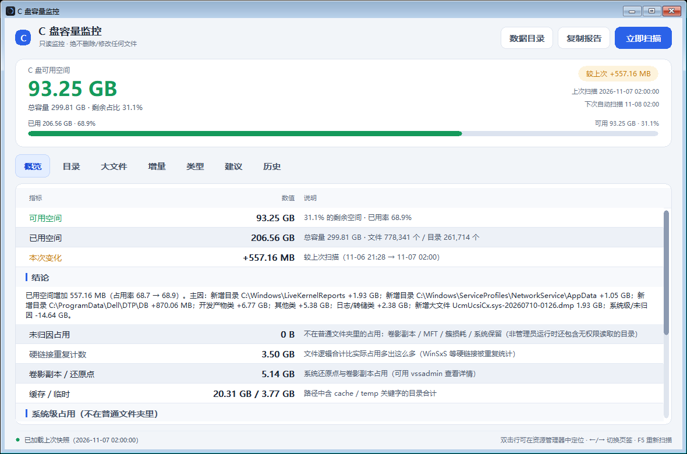
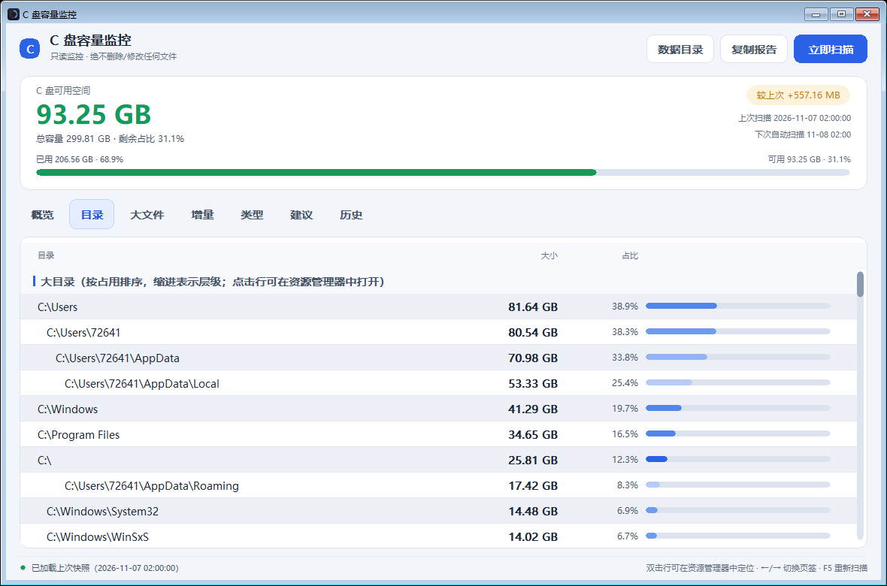
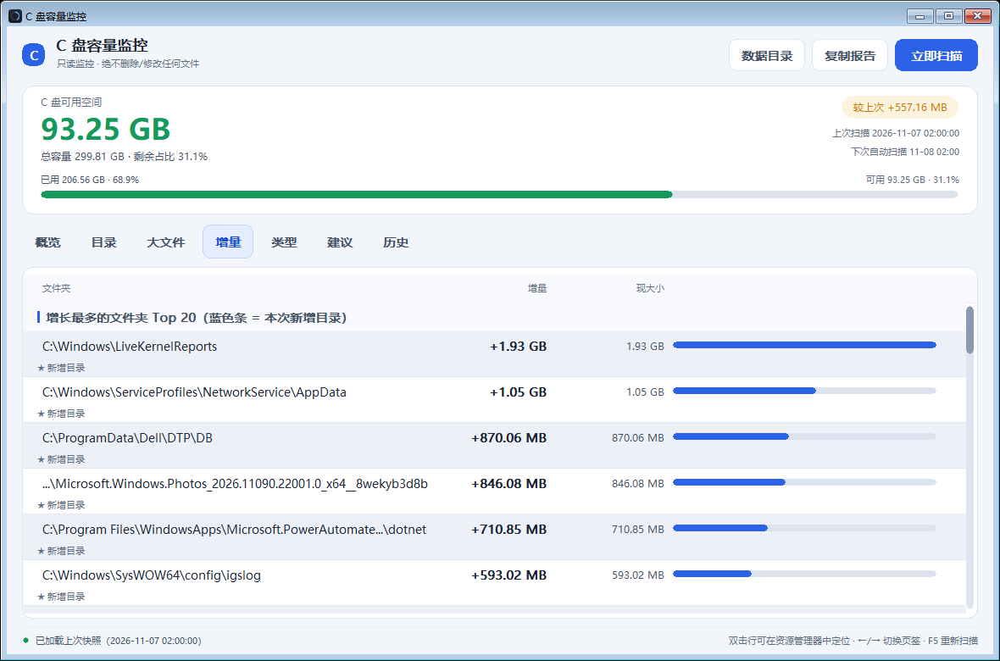
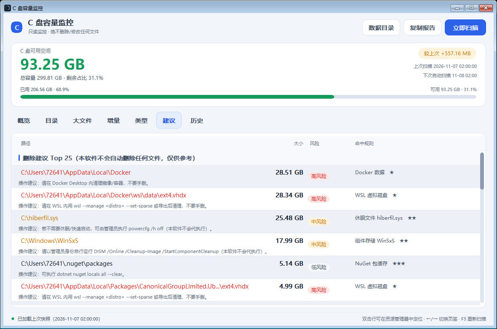
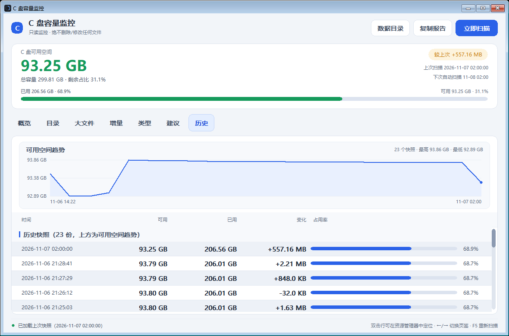
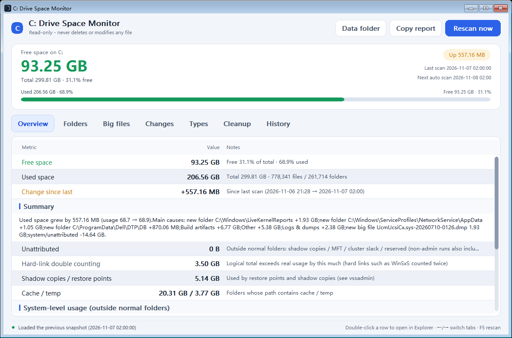
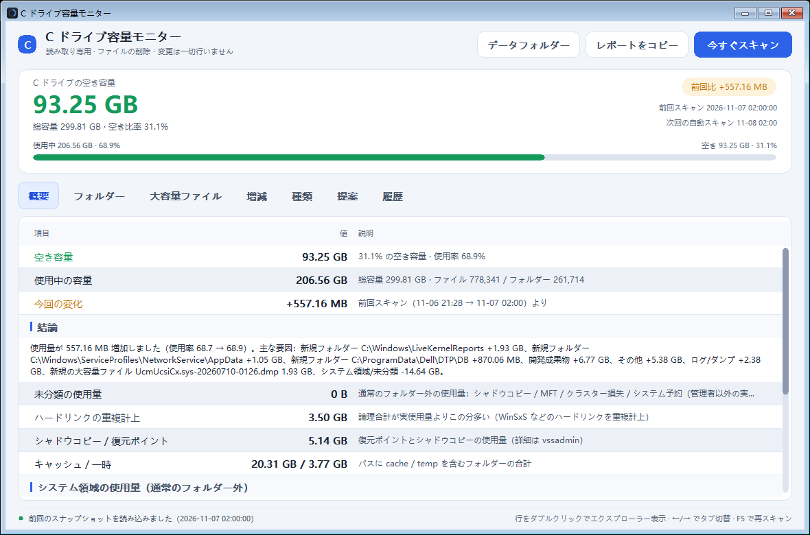

<div align="center">

# C 盘容量监控

### C: Drive Space Monitor

**只读监控 C 盘空间：告诉你是谁在涨、涨的是什么、能不能删。**
**Read-only monitoring for your C: drive: who is growing it, what exactly, and what is safe to remove.**

托盘常驻 **33 MB** 工作集 · 单文件 **12.5 MB** · 零依赖 · 中 / 日 / 英三语
**33 MB** working set in the tray · **12.5 MB** single file · zero dependencies · Chinese / Japanese / English

</div>

---

## 一、它解决什么问题 / What it solves

**「C 盘又满了」——但你不知道是哪个目录、哪类文件、这周涨了多少。**
**"C: is full again" — but which folder, which kind of file, and how much did it grow this week?**

**CDiskWatch 每天自动扫一次全盘，把变化拆成目录 / 类别 / 文件三级归因，并给出只读、可执行的清理建议。**
**CDiskWatch scans the whole drive once a day, attributes the change to folders, file types and individual files, and turns it into read-only, actionable cleanup advice.**

**它永远不会删除或修改你的任何文件——只告诉你哪里可以自己动手。**
**It never deletes or modifies a single file on your disk — it only tells you where you can act yourself.**

---

## 二、功能 / Features

| English | 中文 |
|---|---|
| **Daily full-disk scan** — native `FindFirstFile/FindNextFile`, zero allocation per file, ~700k files in ~13 s. | **每日全盘扫描** —— 原生 `FindFirstFile/FindNextFile`，每个文件零分配，约 70 万文件 13 秒扫完。 |
| **Snapshot repository** — GZip binary snapshots (baseline + one per day, ~117 KB each), kept for a year. | **快照仓库** —— GZip 二进制快照（基线 + 每日一份，约 117 KB），可留存一年。 |
| **Three-level attribution** — what grew, broken down by directory, by file category and by individual file. | **三级归因** —— 涨了多少，按目录、文件类别、单个文件逐层拆开。 |
| **15 file categories** — by extension and by path keyword (cache / temp / logs / dumps …). | **15 类文件分类** —— 按扩展名与路径关键字（缓存 / 临时 / 日志 / 转储……）。 |
| **Cleanup suggestions** — 30 rules with risk level, star rating and a concrete tip; suggestions only, never actions. | **删除建议** —— 30 条规则，带风险等级、推荐星标与具体操作提示；只给建议，绝不代劳。 |
| **Alerts** — free space, daily growth rate, new large files and system-file jumps, with a cool-down window. | **预警** —— 剩余空间、单日增长、新增大文件、系统文件异动，带冷却窗口避免刷屏。 |
| **System-level usage** — shadow copies / restore points, `hiberfil.sys`, `pagefile.sys`, `swapfile.sys`, WinSxS. | **系统级占用** —— 卷影副本 / 还原点、休眠文件、虚拟内存、UWP 交换文件、WinSxS 组件存储。 |
| **Trend history** — free-space curve with min/max markers plus a per-snapshot change table. | **历史趋势** —— 可用空间曲线（含最高 / 最低标记）与逐份快照变化表。 |
| **Tray resident** — status icon (green → yellow → orange → red), tooltip with live free space, balloon notifications, right-click menu. | **托盘常驻** —— 状态图标（绿→黄→橙→红）、实时可用空间提示、气泡通知、右键菜单。 |
| **Trilingual UI** — Chinese, Japanese and English; external language packs in `%AppData%\CDiskWatch\lang\*.json`. | **三语界面** —— 中文 / 日本語 / English；可用 `%AppData%\CDiskWatch\lang\*.json` 外部语言包扩展。 |
| **CLI & JSON report** — `--scan`, `--report`, `--report --format json`, `--winsxs`, `--selftest`, `--lang`. | **命令行与 JSON 报告** —— `--scan`、`--report`、`--report --format json`、`--winsxs`、`--selftest`、`--lang`。 |
| **Read-only by construction** — an IL-level guard in the self-test fails the build if any delete/move API is ever called. | **只读红线** —— 自检用 IL 扫描断言"任何删除/移动类 API 一旦被调用即失败"。 |
| **Zero dependencies** — pure Win32 P/Invoke + GDI, no WinForms/WPF/WebView/NuGet, no .NET runtime needed. | **零依赖** —— 纯 Win32 P/Invoke + GDI 自绘，无 WinForms/WPF/WebView/NuGet，**不需要安装 .NET 运行时**。 |
| **Headless self-test** — 89 assertions including snapshot round-trip, font metrics and trilingual key/placeholder parity. | **无头自检** —— 89 项断言，含快照往返、字体测量与三语 key / 占位符一致性。 |

---

## 三、低占用 / Low footprint

**This is the part we care most about: a disk watcher must not cost you anything while it watches.**
**这是我们最在意的一点：常驻的磁盘监控不该让你付出任何代价。**

*(Measured on the published single-file build, 1180×780 window, ~700k files on the C: drive.)*
*（以下为发布版单文件的实测数据，窗口 1180×780，C 盘约 70 万文件。）*

| Scenario / 场景 | Working set / 工作集 | Private / 私有内存 | Handles / 句柄 |
|---|---|---|---|
| Tray resident, panel closed / 托盘常驻（面板关闭） | **33 MB** | **11 MB** | 253 |
| Panel open / 面板打开 | 42 MB | 14 MB | 337 |
| During a full scan (peak) / 全盘扫描中（峰值） | 75 MB | 44 MB | **374** |
| Right after a scan (auto-released) / 扫描结束后（自动回收） | **14 MB** | 22 MB | 358 |

**Single-file executable, 12.5 MB, self-contained and trimmed — copy it anywhere and run it.**
**单文件可执行程序 12.5 MB，自包含 + 裁剪，拷到哪都能直接跑。**

**Why it is so light: a native scanner that allocates nothing per file, a history page that caches ~120-byte headers instead of 1.3 MB snapshots, and an aggressive GC pass that returns the freed pages to the OS after every scan.**
**为什么这么轻：扫描器原生遍历、每个文件零分配；历史页只缓存约 120 字节的快照头而不是 1.3 MB 的完整快照；每次扫描后用激进 GC 把已释放的内存页还给操作系统。**

**A naive implementation of the same feature uses tens of thousands of file handles and hundreds of MB; this one stays under 400 handles.**
**同样功能的朴素实现会占用数万句柄、数百 MB 内存；这里的实现始终不超过 300 个句柄。**

---

## 四、界面 / Screenshots

### 概览 · 空间变化与结论 / Overview — space, change and verdict



**Free space, used ratio, the delta since the last scan, a one-sentence verdict and every category of hidden usage — all on one screen.**
**可用空间、已用率、与上次扫描的增量、一句话结论，以及所有"看不见的占用"——一屏看完。**

### 目录 · 谁在涨 / Folders — who is growing



**Every folder larger than 1 MB, indented by depth, click to open it in Explorer.**
**所有大于 1 MB 的目录，按层级缩进展示，点击即可在资源管理器中定位。**

### 增量 · 三级归因 / Changes — three-level attribution



**Growth and shrinkage per folder, per file category and per new large file.**
**按目录、按文件类别、按新增大文件分别列出增长与收缩。**

### 建议 · 只给建议，绝不代删 / Cleanup — advice only, never deletion



**Each suggestion shows the path, the size, the risk level and a concrete instruction; the footer repeats that this tool never deletes anything.**
**每条建议都给出路径、体积、风险等级与具体做法；页脚再次强调本软件不会自动删除任何文件。**

### 历史 · 可用空间趋势 / History — free-space trend



**The free-space curve across every snapshot ever taken, with the highest and lowest point marked.**
**历次快照的可用空间曲线，并标出最高点与最低点。**

### English / 日本語





**The same window in English and Japanese — text is measured at runtime, so tabs and buttons resize to fit instead of truncating.**
**同一个窗口的英文与日文界面——文字宽度在运行时实测，页签与按钮会自动撑开而不是被截断。**

---

## 五、快速开始 / Quick start

```bash
# 托盘常驻（首次启动会自动提权，用于读取卷影副本与系统文件占用）
# Tray resident (elevates once to read shadow copies and system file usage)
CDiskWatch.exe

# 立即全盘扫描并存快照
# Run a full scan right now and store the snapshot
CDiskWatch.exe --scan

# 打印今日报告（目录 / 类别 / 建议）
# Print today's report (folders / categories / suggestions)
CDiskWatch.exe --report

# 结构化报告，给脚本用（语言无关的稳定代码）
# Structured report for scripts (stable, language-independent codes)
CDiskWatch.exe --report --format json

# 与基线对比（自第一次扫描起的累计变化）
# Compare against the baseline (everything since the very first scan)
CDiskWatch.exe --report --baseline

# 指定界面语言
# Pick the interface language
CDiskWatch.exe --report --lang en-US

# 无头自检（89 项断言）
# Headless self-test (89 assertions)
CDiskWatch.exe --selftest
```

**Data lives in `%AppData%\CDiskWatch\`: `config.json` (thresholds, schedule, language), `history\*.snap` (daily snapshots), `lang\*.json` (optional language packs).**
**数据目录是 `%AppData%\CDiskWatch\`：`config.json`（阈值、计划、语言）、`history\*.snap`（每日快照）、`lang\*.json`（可选语言包）。**

---

## 六、只读红线 / The read-only guarantee

**Source level: the core code never calls `File.Delete`, `Directory.Delete`, `File.Move` or `File.Create`.**
**源码层：核心代码从不调用 `File.Delete`、`Directory.Delete`、`File.Move`、`File.Create`。**

**Build level: the self-test scans the compiled assembly's IL and fails the release if any delete-style API is called outside the whitelist.**
**构建层：自检扫描程序集 IL，除白名单外一旦出现删除类调用即中止发布。**

**Runtime level: no backup/ownership privileges are requested; the only child processes are read-only queries (`vssadmin`, `DISM /AnalyzeComponentStore`).**
**运行层：不申请备份/所有权权限；唯一的子进程是只读查询（`vssadmin`、`DISM /AnalyzeComponentStore`）。**

**Every "cleanup" string in the UI states that the software never deletes any file.**
**界面上每一句"清理"文案都写明本软件不会自动删除任何文件。**

---

## 七、多语言 / Languages

**Chinese, Japanese and English ship in the binary; a language pack in `%AppData%\CDiskWatch\lang\<code>.json` can override or extend any string.**
**中、日、英三种语言内置在二进制里；`%AppData%\CDiskWatch\lang\<code>.json` 的语言包可覆盖或扩展任意文案。**

**The UI language follows the system by default and can be pinned in `config.json` (`"Lang": "en-US"`), or forced per run with `--lang`.**
**界面语言默认跟随系统，可在 `config.json` 里固定（`"Lang": "en-US"`），也可在命令行用 `--lang` 强制指定。**

**Strings live in `tools/lang/lang.tsv`; a guard script rejects a key typo, a missing translation or a hard-coded Chinese string.**
**文案集中在 `tools/lang/lang.tsv`；守卫脚本会拦下 key 拼错、漏翻和写死的中文。**

---

## 八、构建 / Building

```bash
dotnet build CDiskWatch/CDiskWatch.csproj -c Release      # 0 warnings
CDiskWatch/bin/Release/net8.0-windows/CDiskWatch.exe --selftest
powershell -File build/publish.ps1                        # single file, self-contained, trimmed
```

**More documentation: [`docs/plan.md`](docs/plan.md) (design), [`docs/audit.md`](docs/audit.md) (41 defects found and fixed), [`docs/i18n-plan.md`](docs/i18n-plan.md) (trilingual architecture), [`docs/memory-plan.md`](docs/memory-plan.md) (memory optimisation with measurements).**
**更多文档：[`docs/plan.md`](docs/plan.md)（设计）、[`docs/audit.md`](docs/audit.md)（审计出的 41 个缺陷及修复）、[`docs/i18n-plan.md`](docs/i18n-plan.md)（三语架构）、[`docs/memory-plan.md`](docs/memory-plan.md)（内存优化与实测）。**
